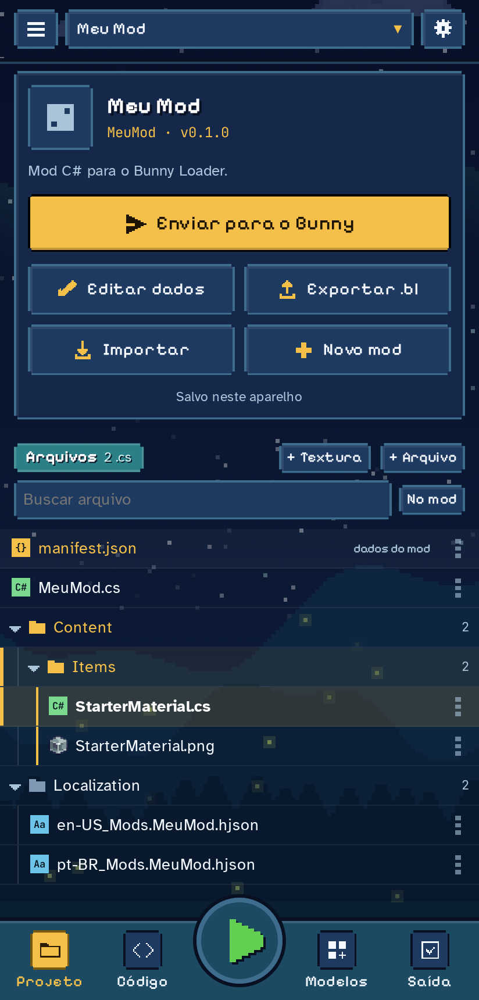
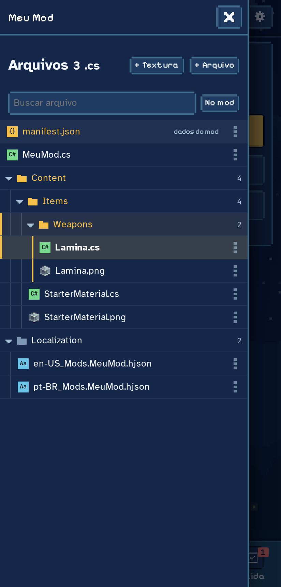
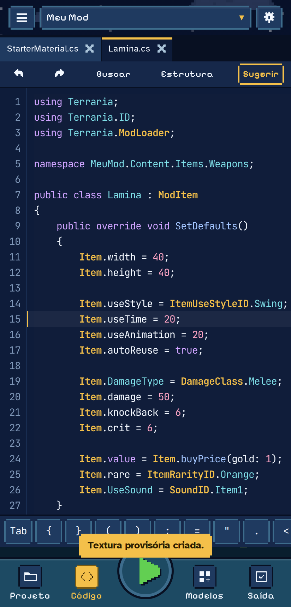
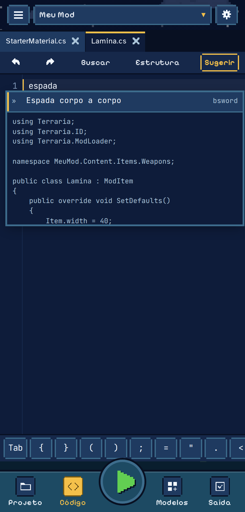
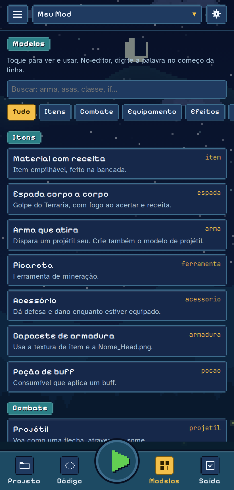
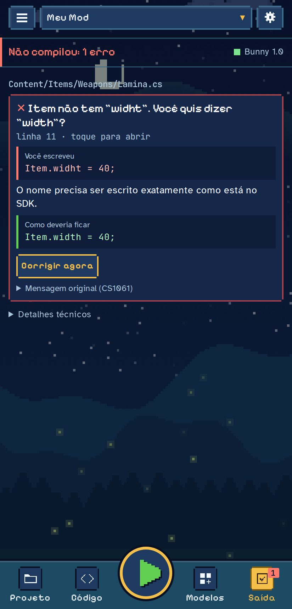
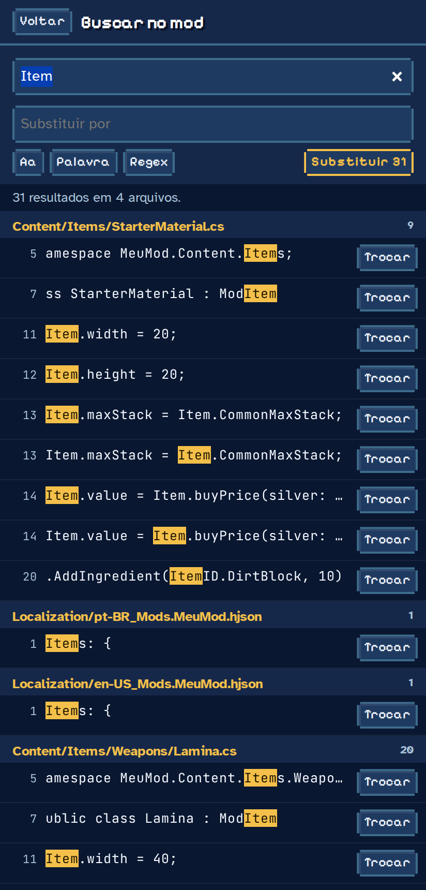
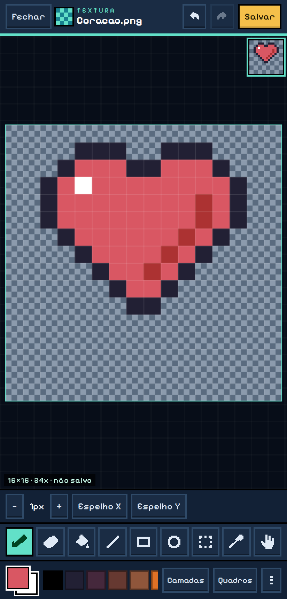
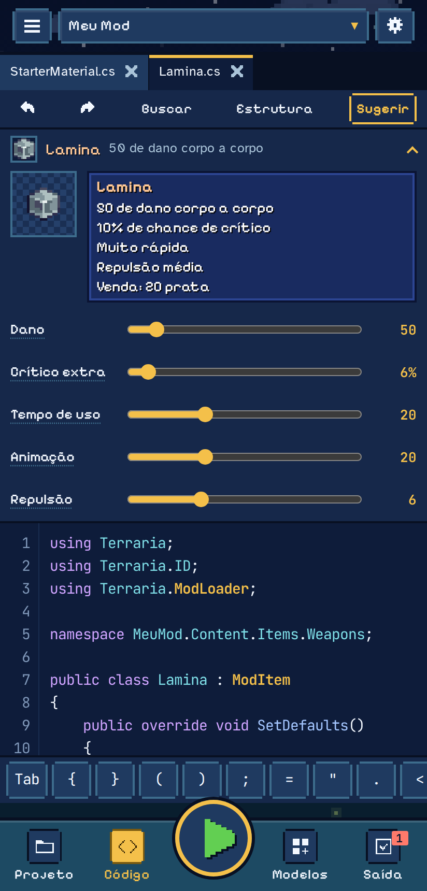
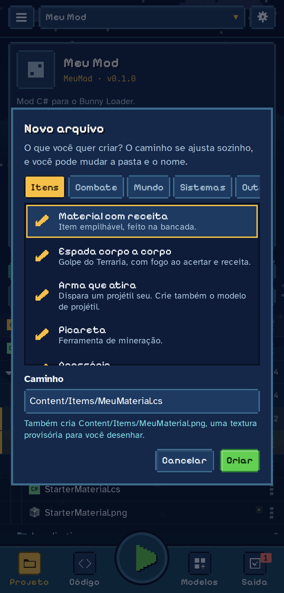

# Csharp Editor

Editor de código para Android que escreve e compila mods C# do [Bunny Loader](https://github.com/JonataOliveiraa/Bunny-Loader) no próprio celular.

Criado por [Mantovani](https://github.com/MantovaniDevTrue).

O app se chama **Bunny C# Studio**.

## Baixar

[**Baixar o APK**](https://github.com/MantovaniDevTrue/Csharp-Editor/releases/download/editor-latest/BunnyCSharpStudio.apk), publicado a cada mudança no app. Precisa do Android 8.0 ou mais novo e do Bunny Loader instalado para compilar.

## Prints

| Projeto | Arquivos | Código | Autocomplete |
|---|---|---|---|
|  |  |  |  |

| Modelos | Erros explicados | Buscar no mod | Textura |
|---|---|---|---|
|  |  |  |  |

| Prévia viva | Novo arquivo |
|---|---|
|  |  |

## Funções

### Código
- **Prévia viva:** em um item, NPC ou projétil, mostra o cartão como no jogo, lendo o próprio código. Arrastar um controle muda o número na linha certa, e a raridade e o tipo de dano ficam a um toque.
- Novo arquivo com item, arma, NPC, projétil, buff, bloco, parede, sistema, classe, tradução e mais.
- Destaque de C#, barra de símbolos e várias abas de arquivos abertos.
- Autocomplete com a API do Bunny instalado: classes, membros, overrides, `using` e classes do seu mod.
- Modelos prontos que nascem de uma palavra: digite `espada` e a classe inteira aparece.
- Busca e substituição no arquivo ou no mod inteiro, com palavra inteira, regex e desfazer.

### Compilação
- Compila no celular, com o Roslyn e o compilador do Bunny Loader.
- Erros em português: o que você escreveu, o motivo e como deveria ficar.
- **Corrigir agora** nos erros que têm uma única resposta certa.
- Conferência do `manifest.json` com as regras do Bunny antes de compilar.

### Texturas
- Editor em pixel com lápis, borracha, balde, linha, retângulo, círculo, seleção e conta-gotas.
- Camadas, quadros de animação, espelho, paleta, prévia e zoom com dois dedos.
- Nova textura para o conteúdo do mod, com as classes que ainda não têm imagem, ou para trocar imagens do jogo em um pacote.
- Seletor de cor com mira e lupa, para ver a cor mesmo com o dedo em cima.

### Pacotes e fontes
- Mods em C#, pacotes de texturas e pacotes de fontes.
- Gerador das cinco fontes do jogo a partir de um `.ttf` ou `.otf`.
- Ícone do mod, importação e exportação de `.bl`, e envio para o Bunny.

### App
- Barra lateral de arquivos, no estilo de um editor de PC.
- Configurações do editor, tutorial opcional e cenário animado.
- Layout testado em telas de 280 a 1280 pixels de largura.

## Organização

```text
app/                    App Android em .NET 10
  Source/
    MainActivity.cs     Tela e ponte com a interface
    Bunny/              Bunny instalado e pasta ModSources
    Compilador/         Compilação e leitura da API
  Resources/            Ícone, cores e textos do Android
web/                    Interface mostrada dentro do app
  index.html            Estrutura da página
  styles/               CSS, por área
  data/                 Índice inicial da API (gerado)
  scripts/
    nucleo/             Estado, configurações, ZIP e utilidades
    editor/             Editor, autocomplete, busca e teclado
    csharp/             Lexer, API, manifest e verificação rápida
    modelos/            Modelos prontos e o painel deles
    compilador/         Compilação, explicação e correção dos erros
    projeto/            Árvore, barra lateral, mods, importar e exportar
    textura/            Editor de texturas: documento, ferramentas, tela e painéis
    fontes/             Gerador de fontes
    bunny/              Conexão com a pasta do Bunny
    telas/              Tutorial e configurações
    cenario/            Fundo animado
    testes/             Mods usados nos testes do app
tools/                  Build da interface, índice da API e traduções
tests/                  Testes da interface e teste no emulador
docs/prints/            Prints deste README, gerados pelo workflow "Prints do README"
bunny-upstream.txt      Commit do Bunny Loader usado no build
```

Os scripts de `web/` dividem o mesmo escopo e viram uma página só no build. A ordem deles fica em `web/scripts/ordem.txt`, e arquivo novo precisa entrar nessa lista.

## Como compila

1. O workflow baixa o Bunny Loader no commit de `bunny-upstream.txt` e usa o `ModCompiler` dele.
2. No celular, o app lê `assets/dotnet/BunnyLoader.dll` e as referências do APK do Bunny instalado.
3. O app também gera o autocomplete a partir dessa DLL. O arquivo `web/data/sdk-index.json` só vale até a leitura terminar.

Para atualizar o Bunny usado no build, troque o commit em `bunny-upstream.txt`.

## Testar

Testes da interface, com Python, Playwright e um checkout do Bunny Loader:

```bash
pip install playwright
python3 -m playwright install chromium
BUNNY_UPSTREAM=../bunny-loader python3 tests/run_tests.py
```

No GitHub Actions, `tests/emulator_smoke.sh` também compila código certo e errado dentro do APK, em um emulador. Como lá não existe Bunny instalado, esse teste usa `tools/stub-api`. Para testar os modelos contra a API real, abra no celular **Configurações > Testar os modelos**.


## Pasta do Bunny

O app acessa a pasta `ModSources`: a activity de ponte do Bunny entrega a permissão da pasta, e o provider dele instala o projeto.

O Bunny só libera essa ponte para apps assinados com a chave dele. Com outra chave, o app oferece escolher a pasta no seletor do Android e a instalação é feita no próprio Bunny.
